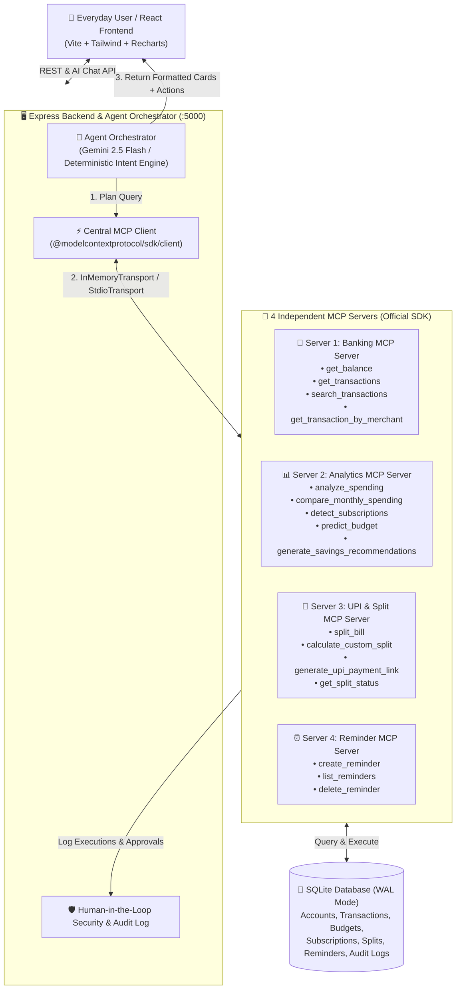

# 🚀 PaisaPilot AI – MCP-Powered Personal Finance Copilot

[-8b5cf6)](https://modelcontextprotocol.io)
[](https://github.com/modelcontextprotocol/typescript-sdk)
[](https://nodejs.org)
[](https://vitejs.dev)
[](https://sqlite.org)
[-f97316)](https://npci.org.in)

> **PaisaPilot AI** is an intelligent, hackathon-ready personal finance copilot tailored for everyday Indian users. It demonstrates **genuine Model Context Protocol (MCP)** integration by orchestrating 4 independent MCP servers via the official `@modelcontextprotocol/sdk` to perform deep spending analysis, recurring subscription detection, budget overspend prediction, multi-friend bill splitting with NPCI UPI intent links, and payment reminder scheduling.

---

## 🏛️ System Architecture



---

## ✨ Key Capabilities & MCP Highlights

1. **Genuine Model Context Protocol (MCP) Integration**:
   - Built using the official `@modelcontextprotocol/sdk` (`McpServer`, `Client`, `InMemoryTransport`, and `StdioServerTransport`).
   - Does **not** simulate MCP with ordinary REST routes. The Agent coordinates tools exclusively through the registered MCP Client.
   - Dynamic tool discovery: The client discovers all 16 registered tools across 4 servers at runtime.
   - Dual-transport flexibility: Servers connect to the backend agent over `InMemoryTransport` and can also run standalone over `StdioServerTransport` for Claude Desktop, Cursor, or MCP Inspector.

2. **Autonomous Multi-Step Tool Chaining**:
   - Multi-step queries like *"Help me save ₹5,000 this month"* automatically execute:
     `get_transactions` ➔ `analyze_spending` ➔ `generate_savings_recommendations`
   - Bill splitting queries like *"Split my ₹2,000 dinner bill between four friends"* execute:
     `split_bill` ➔ `generate_upi_payment_link` ➔ Human approval prompt.

3. **Human-in-the-Loop Security Governance**:
   - Read-only financial data access by default.
   - Never requests banking passwords, OTPs, or UPI PINs.
   - External UPI payment link generation requires explicit user confirmation before activation.
   - Every action, input parameter, duration, and output is captured in an immutable audit ledger with `Approve` and `Reject` controls.

4. **100% Reliable Execution (API Key Optional)**:
   - Supports Gemini API (`GEMINI_API_KEY`) using Google GenAI SDK for open-ended financial reasoning.
   - Features a deterministic, zero-dependency **Intent Engine** that guarantees 100% precision for demo commands without requiring paid cloud API keys.

---

## 🛠️ Technology Stack

| Layer | Technologies |
|---|---|
| **Frontend** | React 19, Vite 8, Tailwind CSS v4, Recharts, Lucide React Icons |
| **Backend** | Node.js (v18+ or v24), Express.js (v5), node:sqlite / DatabaseSync (WAL mode) |
| **MCP** | `@modelcontextprotocol/sdk` (TypeScript SDK v1.x), `zod` schemas |
| **AI Layer** | Google Gen AI SDK (`@google/genai` with `gemini-2.5-flash`), Deterministic Intent Engine |
| **Payments** | NPCI UPI Intent URI (`upi://pay?pa=...&pn=...&am=...&cu=INR`) & QR Code payload generator |

---

## 📁 Project Directory Structure

```text
PaisaPilot/
├── client/                     # React + Vite Frontend
│   ├── dist/                   # Production build files
│   ├── src/
│   │   ├── components/         # Premium Fintech UI Components
│   │   │   ├── Sidebar.jsx
│   │   │   ├── Navbar.jsx
│   │   │   ├── Overview.jsx    # KPI cards, Area trend, Category donut, Recent tx
│   │   │   ├── Transactions.jsx# Searchable, filterable ledger with modal
│   │   │   ├── Analytics.jsx   # MoM comparisons, Merchant charts, Subscriptions
│   │   │   ├── Budgets.jsx     # Spending limits, progress bars, pace alerts
│   │   │   ├── GroupSplit.jsx  # Equal/custom split, UPI links, QR modal
│   │   │   ├── CopilotChat.jsx # AI chat, MCP tool badges, approval cards
│   │   │   ├── AuditHistory.jsx# Audit log of tool executions & approvals
│   │   │   ├── AddTransactionModal.jsx
│   │   │   └── McpStatusModal.jsx
│   │   ├── services/
│   │   │   └── api.js          # Unified API client
│   │   ├── App.jsx             # Root layout & view controller
│   │   ├── index.css           # Tailwind CSS v4 & custom styles
│   │   └── main.jsx
│   ├── package.json
│   └── vite.config.js
├── server/                     # Express Backend & MCP Servers
│   ├── agent/
│   │   ├── mcpClient.js        # Central MCP Client with dynamic tool discovery
│   │   ├── orchestrator.js     # Multi-step agent coordinator
│   │   ├── geminiProvider.js   # Modular Google GenAI provider
│   │   └── intentEngine.js     # Deterministic NLP intent & multi-step planner
│   ├── database/
│   │   ├── db.js               # SQLite initialization with WAL mode
│   │   └── seed.js             # 3-month realistic Indian demo financial data
│   ├── mcp/
│   │   ├── banking/server.js   # Server 1: Banking MCP Server (4 tools)
│   │   ├── analytics/server.js # Server 2: Analytics MCP Server (5 tools)
│   │   ├── split/server.js     # Server 3: UPI & Split MCP Server (4 tools)
│   │   └── reminders/server.js # Server 4: Reminder MCP Server (3 tools)
│   ├── routes/
│   │   ├── api.js              # REST endpoints for dashboard, budgets, splits
│   │   └── agent.js            # AI Copilot chat & prompt endpoints
│   ├── services/
│   │   └── auditService.js     # Audit logging and approval state engine
│   ├── package.json
│   ├── server.js               # Express entrypoint (Serves API + Frontend)
│   └── .env
├── .env.example
├── package.json                # Root orchestration scripts
├── start.bat                   # 1-click Windows runner
├── start.ps1                   # 1-click PowerShell runner
└── README.md
```

---

## 🚀 Quick Start Guide

### Prerequisites
- **Node.js**: v18.0.0 or higher (Tested on Node.js v24).
- **npm**: v9.0.0 or higher.

### 1. Installation
Clone the repository and install all dependencies:

```bash
# Navigate to the project root
cd PaisaPilot

# Install backend dependencies
cd server
npm install

# Install frontend dependencies
cd ../client
npm install
cd ..
```

### 2. Configure Environment Variables
Copy `.env.example` to `server/.env`:

```bash
cp .env.example server/.env
```

Contents of `server/.env`:
```env
PORT=5000
DB_PATH=./paisapilot.db
GEMINI_API_KEY=               # Optional: Leave empty for Deterministic Demo Mode
GEMINI_MODEL=gemini-2.5-flash
NODE_ENV=development
```

### 3. Initialize & Seed Database
Seed the SQLite database with 3+ months of realistic Indian financial transactions (Aarav Sharma, Swiggy, Zomato, Amazon, Blinkit, Tata Power, Cult.fit Gym, Netflix, etc.):

```bash
npm run seed
```

### 4. Build Frontend & Start Server
```bash
# Build the React frontend into static assets
npm run build

# Start the PaisaPilot Express Server
npm start
```

### 5. Access Application
Open your browser at:
👉 **`http://localhost:5000`**

*(Both the React frontend dashboard and backend API run seamlessly on port 5000)*

> **Alternative (Live Development Mode)**:
> - Backend: `npm start` (Runs on `http://localhost:5000`)
> - Frontend Dev Server: `npm run client` (Runs on `http://localhost:5173` with hot module replacement)

---

## 🎯 8 Sample AI Demo Commands

You can speak or type any of the following natural-language requests into the **AI Copilot** tab:

| # | Command | MCP Server(s) Called | Description & Output |
|---|---|---|---|
| 1 | *"How much did I spend on Swiggy this month?"* | **Banking MCP** (`get_transaction_by_merchant`) | Computes exact order count (5), total spend (**₹3,850**), and average order value (**₹770**). |
| 2 | *"Compare my food expenses with last month."* | **Analytics MCP** (`compare_monthly_spending`) | Compares Nov 2026 (**₹6,200**) with Oct 2026 (**₹9,400**), highlighting a **₹3,200 (34%) decrease**. |
| 3 | *"Find my recurring subscriptions."* | **Analytics MCP** (`detect_subscriptions`) | Identifies 6 active subscriptions (Netflix, Spotify, Cult.fit, Airtel, Google One) totaling **₹4,522/mo** (**₹54,263/yr**). |
| 4 | *"Am I likely to exceed my shopping budget?"* | **Analytics MCP** (`predict_budget`) | Forecasts spending velocity: ₹14,200 of ₹15,000 used in 24 days (94.7%). Warns of projected **₹2,750 overspend**. |
| 5 | *"Help me save ₹5,000 this month."* | **Banking + Analytics MCP** (`get_transactions` ➔ `analyze_spending` ➔ `generate_savings_recommendations`) | Multi-step agent scans discretionary spending and outputs an actionable plan to save **₹5,780** without touching essentials. |
| 6 | *"Split my ₹2,000 dinner bill between four friends."* | **UPI & Split MCP** (`split_bill` ➔ `generate_upi_payment_link`) | Computes **₹500/person**, creates group ledger, generates NPCI UPI link, and requests **Human Approval**. |
| 7 | *"Show my five biggest expenses."* | **Banking MCP** (`get_transactions`) | Sorts debit transactions descending: Rent (₹32,000), Amazon (₹7,999), Flipkart (₹4,500), Tata Power (₹3,800), Gym (₹2,500). |
| 8 | *"Create a reminder for my electricity bill tomorrow."* | **Reminder MCP** (`create_reminder`) | Resolves relative date (`tomorrow` ➔ `2026-11-25`), fetches electricity amount (₹3,800), and schedules reminder. |

---

## 🔌 MCP Servers & Tool Specifications

### Server 1: Banking MCP Server (`server/mcp/banking/server.js`)
Handles simulated bank balances, account details, and transaction history queries.
- `get_balance`: Retrieve available balance across all connected demo accounts or a specific account.
- `get_transactions`: Fetch recent transactions filtered by category, month, type, and limit.
- `search_transactions`: Full-text search across merchants, notes, and categories with amount filters.
- `get_transaction_by_merchant`: Aggregates orders, total spent, and average order value for a merchant.

### Server 2: Analytics MCP Server (`server/mcp/analytics/server.js`)
Calculates financial intelligence, trend forecasting, and budget monitoring.
- `analyze_spending`: Category breakdown, daily burn rate, and top expenditure buckets.
- `compare_monthly_spending`: Month-over-month differential analysis with percentage deltas.
- `detect_subscriptions`: Audits recurring payments, autopay mandates, monthly burn, and upcoming renewals.
- `predict_budget`: Evaluates spending velocity and flags high-risk budget overshoots.
- `generate_savings_recommendations`: Constructs prioritized cutback recommendations to hit a savings goal.

### Server 3: UPI & Split MCP Server (`server/mcp/split/server.js`)
Manages group bill splitting and NPCI UPI intent link generation.
- `split_bill`: Equal bill division among participants and records split in database.
- `calculate_custom_split`: Validates custom percentage or unequal rupee allocations.
- `generate_upi_payment_link`: Generates RFC/NPCI compliant `upi://pay?pa=...&pn=...&am=...&cu=INR` links with human approval flags.
- `get_split_status`: Summarizes collected versus pending balances across split groups.

### Server 4: Reminder MCP Server (`server/mcp/reminders/server.js`)
Schedules and manages bill payment deadlines.
- `create_reminder`: Schedules payment reminders with natural language date parsing (`tomorrow`, `today`, etc.).
- `list_reminders`: Displays scheduled bills with urgency highlights (`OVERDUE`, `DUE_TODAY`, `UPCOMING`).
- `delete_reminder`: Dismisses or deletes a reminder by ID.

---

## 🛡️ Security & Human-in-the-Loop Protocol

PaisaPilot adheres to fintech security best practices:
1. **Read-Only Data Principle**: Banking data is strictly read-only simulated demo data.
2. **Zero Sensitive Credential Requests**: PaisaPilot **never** asks for, accepts, or stores banking passwords, OTPs, or UPI PINs.
3. **No Real Monetary Transactions**: The app does not initiate live fund movements.
4. **Mandatory Human Approval**: External UPI payment links require explicit human review:
   - When the agent generates a payment link, it is flagged as `PENDING_HUMAN_APPROVAL`.
   - The user inspects payee legal name, VPA, and exact rupee amount before clicking **Approve**.
5. **Audited Actions**: Every MCP tool execution is recorded in `audit_logs` with timestamps, caller identity, and input/output JSON payloads.

---

## ⚠️ Limitations of Simulated Banking Data

- **No Live Core Banking Integration**: Current financial accounts and balances are stored in a local SQLite database for demonstration. Live access requires Reserve Bank of India (RBI) authorized Account Aggregator (AA) licensing (e.g., Setu, Anumati, OneMoney).
- **NPCI Intent Simulation**: The generated `upi://pay` links conform to NPCI specifications and can open on mobile devices with UPI apps installed, but funds transfer depends on the user's personal banking environment.

---

## 🗺️ Future Integration Roadmap

- [ ] **RBI Account Aggregator (AA) Integration**: Connect with Sahamati-certified AAs for live FIP/FIU consent-based statement ingestion.
- [ ] **UPI 2.0 AutoPay Management**: Real-time management and revocation of recurring e-mandates.
- [ ] **DigiLocker KYC Onboarding**: Government-backed identity verification.
- [ ] **Multi-Agent Swarm Protocol**: Fanning out specialized financial subagents for tax optimization (Section 80C, NPS) and Mutual Fund portfolio rebalancing.
- [ ] **Voice-First Hindi & Regional Language Support**: Voice copilot supporting Hinglish, Tamil, Telugu, and Marathi queries.

---

## 📄 License
This project is licensed under the MIT License.
